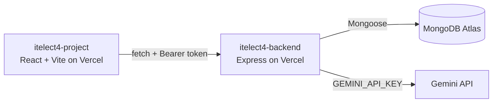

# itelect4-backend

[](https://github.com/shin486/itelect4-backend/actions/workflows/ci.yml)

The REST API behind the ITELECT4 portal: Express in TypeScript, MongoDB Atlas through Mongoose, JWT authentication, and an AI Review endpoint that analyzes student project submissions using the Google Gemini API.

- **Live API:** https://itelect4-backend-tau.vercel.app/api/health
- **Frontend repo:** https://github.com/shin486/itelect4-project

## Architecture



## API Endpoints

| Method | Endpoint | Auth | Description |
|--------|----------|------|-------------|
| GET | `/api/health` | Public | Health check — returns MongoDB connection status |
| POST | `/api/auth/register` | Public | Register a new user |
| POST | `/api/auth/login` | Public | Authenticate user & return signed JWT |
| GET | `/api/auth/me` | Bearer JWT | Retrieve current user profile |
| GET | `/api/courses` | Public | List available courses |
| GET | `/api/submissions` | Bearer JWT | List student submissions |
| POST | `/api/submissions` | Bearer JWT | Create a new submission |
| POST | `/api/ai` | Bearer JWT | Request AI review of project description via Gemini |

## Tech Stack

- **Runtime:** Node.js (v24)
- **Framework:** Express 4
- **Language:** TypeScript 5
- **Database:** MongoDB Atlas via Mongoose 8
- **Authentication:** JWT (`jsonwebtoken`) + `bcryptjs`
- **Validation:** Zod 4
- **AI Integration:** Google Gemini API (`@google/genai`)
- **Testing:** Vitest + Supertest
- **CI/CD:** GitHub Actions

## Local Development

```bash
# Install dependencies
npm install

# Copy environment template
cp .env.example .env
# Configure MONGODB_URI, JWT_SECRET, CORS_ORIGIN, GEMINI_API_KEY, PORT

# Run in development with hot reload
npm run dev

# Run automated tests
npm test

# Type-check TypeScript
npm run typecheck

# Build for production
npm run build
```

## Testing & CI

Supertest and Vitest test the protected `POST /api/ai` endpoint:
- Validates rejection of requests missing an Authorization header (`401`).
- Validates rejection of forged or expired tokens (`401`).
- Validates that a valid JWT bypasses `requireAuth` and reaches the request schema without invoking the external Gemini service or connecting to the database.

GitHub Actions runs typecheck and test suites on every push with secret injection.

## AI-Use Disclosure

In accordance with course guidelines, AI coding assistance (Gemini 3.8 / Antigravity) was used for test harness implementation, CI pipeline YAML configuration, Supertest integration validation, and architectural documentation. All route logic and tests were verified and tested locally.
